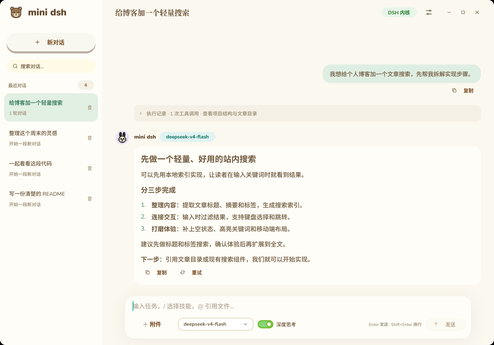
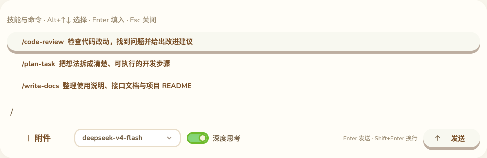
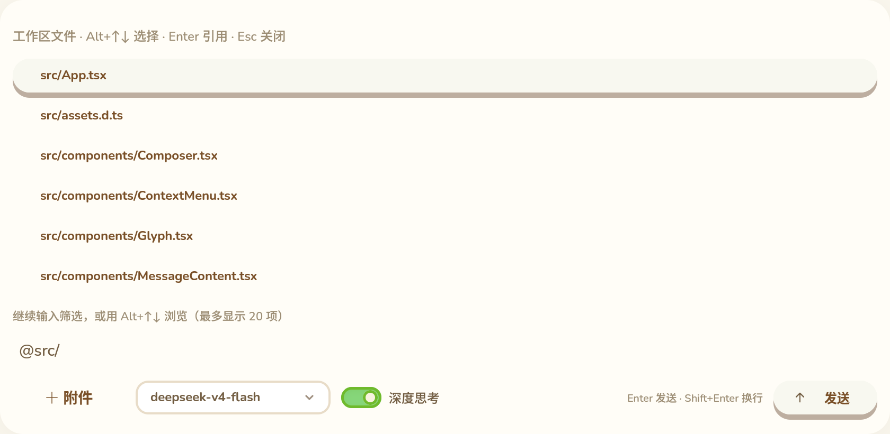

<p align="center">
  
</p>

<h1 align="center">mini dsh</h1>

<p align="center"><strong>给 DeepSeek 一个温暖的桌面。</strong></p>
<p align="center">原生 GPU 界面 · 官方 dsh 内核 · 文件与技能随手调用</p>

<p align="center">
  <a href="https://github.com/liuyanghejerry/mini-dsh/releases/latest"></a>
  <a href="https://github.com/liuyanghejerry/mini-dsh/actions/workflows/ci.yml"></a>
  
</p>

<p align="center">
  <a href="https://github.com/liuyanghejerry/mini-dsh/releases/latest"><strong>下载体验</strong></a> ·
  <a href="#上手只需几步">快速开始</a> ·
  <a href="#从源码运行">源码运行</a> ·
  <a href="CHANGELOG.md">更新日志</a> ·
  <a href="https://github.com/liuyanghejerry/mini-dsh/issues">反馈问题</a>
</p>



<p align="center"><sub>真实应用界面截图；对话与技能列表使用演示数据，不包含私人会话。文件列表来自本项目工作区。</sub></p>

mini dsh 是一个基于官方 [DeepSeek Harness](https://github.com/deepseek-ai/deepseek-harness) 的独立桌面客户端。把写代码、读文件、整理想法放在同一个舒适的窗口里：历史留在左边，任务在右边展开，工具执行的过程也看得见。

界面由 **Vue 3 + GPUIV + Animal Island** 驱动，使用原生 GPU 渲染，不嵌入 Chromium 或 WebView。mini dsh 不是 DeepSeek 官方产品。

## 日常使用，少一点打断

| 你想做的事 | mini dsh 提供的体验 |
| --- | --- |
| 接着上次的工作继续聊 | 发现并恢复官方 dsh 会话，搜索历史对话 |
| 把代码文件交给助手 | `@` 搜索工作区文件，支持句中引用与带空格路径 |
| 让助手按熟悉的流程工作 | `/` 选择当前会话可用的官方技能，补充任务后发送 |
| 看清楚它正在做什么 | 流式回复、思考、工具时间线与权限确认，执行记录可折叠 |
| 一起看图片、讨论附件 | 选择或拖入文件、粘贴图片，支持消息复制与重试 |
| 了解用量、保持更新 | 查看上下文与 Token 用量，检查、校验并安装 AppImage 更新 |

## 两个符号，接上你的工作流

### `/`，找到合适的技能

输入 `/` 查看可用技能和命令，继续输入即可筛选。点击或用 **Alt+↑↓、Enter** 填入，补充任务后发送；**Esc** 关闭菜单。技能由官方 dsh 发现和加载，每个会话使用自己的目录。



### `@`，把文件带进对话

不用来回复制路径。输入 `@` 搜索当前会话工作区文件，选择后直接引用；带空格的路径会自动加引号。搜索遵守 Git 忽略规则，并跳过 `.git`、`node_modules` 和 `.mini-dsh`。文件由 dsh 按需读取。



## 上手只需几步

**当前提供 Linux x64 AppImage**，由 Ubuntu 24.04 构建，面向该版本及更新的兼容发行版。其他系统可关注后续发布。

1. 在 [最新 Release](https://github.com/liuyanghejerry/mini-dsh/releases/latest) 下载 `.AppImage` 和 `SHA256SUMS`，放在同一目录。
2. 校验文件，赋予执行权限后启动：

   ```bash
   sha256sum -c SHA256SUMS
   chmod +x mini-dsh-*.AppImage
   ./mini-dsh-*.AppImage
   ```

3. 在设置中配置 API Key 和工作区。如果已经使用官方 dsh，默认会读取 `~/.dsh` 中的会话；使用其他 home 时可在设置中选择。

AppImage 已内置 dsh 运行时，无需为发行版安装 Bun 或单独安装 dsh。仍需系统图形驱动和 X11/XKB 等运行库；首次运行会释放内嵌运行时。

<details>
<summary><strong>已有 dsh 用户：数据位置与迁移</strong></summary>

- `DSH_HOME` 环境变量优先，其次是界面保存的选择；新用户默认使用官方 `~/.dsh`。
- 已有用户可在设置中选择 **“使用官方 ~/.dsh”**，保存后重启应用。
- 不同 home 的会话分别显示，旧目录中的缓存不会删除。
- 凭据和官方会话由 dsh 管理，mini dsh 不复制或解析官方凭据文件。
- 界面缓存独立保存在当前工作目录的 `.mini-dsh/ui-v2.json`。
- ACP 负责恢复会话、继续对话和权限控制，不回放早期消息；真实标题与历史通过官方 dsh Web 的只读 Session Controller 获取，不打开浏览器。
- 官方 Web 特有的插件、profile 和完整工作台面不保证自动迁移。避免在两个客户端中同时写入同一会话。

</details>

<details>
<summary><strong>自动更新如何工作</strong></summary>

应用启动时及每 6 小时从本仓库 GitHub Releases 检查最新稳定版；也可在设置中手动检查。发现新版后显示提示，点击下载会验证版本对应的 AppImage 大小和 `SHA256SUMS`。仅通过 HTTPS 下载，不使用 GitHub 私有凭据。

通过 AppImage 启动时，可在没有执行中任务的情况下点击“安装更新”；更新文件会在原 AppImage 所在目录暂存并原子替换，关闭后再次打开生效。目录不可写时会提示手动更新。源码运行只下载到 `~/.cache/mini-dsh/updates/`，不会替换 Bun 或源码。检查失败不干扰聊天；手动检查会显示错误。

</details>

## 从源码运行

需要 Bun、uv，以及可构建 GPUIV 的开发环境。Animal Island 组件库与 GPUIV packager 使用 npm 发布的 `0.1.0` 版本，由 `bun install` 安装；Vue 适配器和 native binding 仍链接相邻的 GPUIV 源码 checkout。

```bash
git clone --recurse-submodules https://github.com/liuyanghejerry/gpuiv.git
git clone https://github.com/liuyanghejerry/mini-dsh.git

cd gpuiv
bun install
bun run build

cd ../mini-dsh
bun install
bun run setup:dsh
bun run build
bun run start
```

`bun run setup:dsh` 通过 uv 安装固定的 `deepseek-harness-runtime-bin==0.2.1rc2`。GPUIV 位于其他目录时，可设置 `GPUIV_ROOT` 或修改 `package.json` 中的 `gpuiv.root`。

## 打包

```bash
# 原生 Linux 可执行文件和 tar.gz
bun run package

# 同时生成 Linux x64 AppImage
bun run package:appimage
```

AppImage 输出为 `dist/package/mini-dsh-0.1.0-linux-x86_64.AppImage`。打包包含 `LICENSE`、`NOTICE` 和 `licenses/`，不包含本地会话、凭据或测试工作区。

默认发行 Linux x64 AppImage。GitHub Actions 在 Ubuntu 24.04 构建，面向该版本及更新的兼容发行版；本机自行打包的 glibc 要求取决于构建环境。仍需系统图形驱动和 X11/XKB 等运行库。首次运行会释放内嵌的 dsh 运行时。

## 验证

```bash
bun run build
bun run package:appimage
```

使用 `bun run test` 运行项目回归；`bun run test:skills-runtime` 使用临时工作区和本地模拟模型服务验证技能发现、`/技能名` 的真实 ACP 调用，以及 `@文件` 引用和实际文件读取，不使用真实账号凭据。

发布前还应进行纯内存或 headless 的 ACP 回归和 AppImage 挂载检查。不要用真实账号凭据做自动化测试；GUI 验证与无窗口回归应分开进行。

## 架构

```text
Vue 3 + TypeScript + Animal Island
                │
             GPUIV / GPUI
                │
       ┌────────┴────────┐
       │                 │
Agent Client Protocol   官方 Web 只读接口
       │                 │
       └──── 官方 dsh ────┘
```

mini dsh 只维护桌面界面、ACP 执行适配、官方 Web 只读历史适配和界面缓存，不另行实现一套 Agent harness。

<details>
<summary><strong>维护者说明：CI、Release 与更新日志</strong></summary>

- 推送 `main`、提交 PR 或手动运行 CI：类型检查、回归测试、构建 AppImage、解包后运行无凭据 `--self-test`，并上传 AppImage 和 SHA256SUMS 构建产物（保留 14 天）。
- 推送 `v*` 标签：校验标签与 `package.json`、`gpuiv.package.json` 的版本一致，使用同一构建流程，成功后创建 GitHub Release，上传 AppImage 和校验文件。含连字符的版本作为预发布。
- 发布示例：将两个清单版本都更新为 `0.1.1` 并提交后，执行 `git tag v0.1.1`、`git push origin v0.1.1`。普通代码推送不会发布版本。
- GPUIV 固定在工作流指定的提交；升级时需同步修改 checkout 的 SHA 和原生缓存键。Bun、uv 和 dsh 运行时也固定版本。
- Release 仅发布任务具有 `contents: write`；检查和构建无需账号凭据。GUI 鼠标交互仍需另行验证。
- 源码运行可执行 `bun run install:desktop` 安装当前用户的启动项与小熊图标；启动项指向当前 checkout。

### 发布更新日志

发布前在 `CHANGELOG.md` 新增与标签对应的章节，例如 `## [0.1.1]`，填写本版新增、修复和兼容性说明。`Unreleased` 用于暂存未发布修改，不会进入发行说明。发布流程会在构建前拒绝缺失、重复或空的版本章节。

Release 正文包含该版本的中文更新日志，以及 GitHub 自动生成的提交/PR、贡献者和对比链接。重新运行发布任务会同步更新发行说明。可在本地运行 `bun scripts/release-notes.mjs v0.1.0` 预览版本正文。
</details>

## License 与 Credits

mini dsh 自有代码采用 [MIT License](LICENSE)。第三方组件仍遵循各自许可证，详见 [NOTICE](NOTICE) 和 [licenses/](licenses/)。

**Animal Island 的上游声明包含学习与非商业使用限制，GPUIV 移植版也遵循该约束。因此，包含这些组件的整体分发和使用仍需遵守该约束；自有代码的 MIT 许可证不代表整个应用可无条件商业使用。**

主要致谢：

- [GPUIV](https://github.com/liuyanghejerry/gpuiv)：Vue 3 自定义渲染器、原生 GPUI 集成和 Animal Island 移植，Apache-2.0；同时保留其 GPUIX、GPUI、Comet 等上游声明。
- [Animal Island Vue](https://github.com/guokaigdg/animal-island-vue)：原始 Vue UI 库，作者 guokaigdg，MIT 及上游使用声明。
- [Animal Island UI](https://github.com/guokaigdg/animal-island-ui)：React 组件、图形资产与交互参考，作者 guokaigdg。
- [Vue](https://github.com/vuejs/core)：Vue 3 与响应式系统，MIT。
- [DeepSeek Harness](https://github.com/deepseek-ai/deepseek-harness)：官方 dsh 和 ACP harness，MIT；其依赖保留各自的许可证。
- [Agent Client Protocol TypeScript SDK](https://github.com/agentclientprotocol/typescript-sdk)：ACP 客户端协议支持，Zed Industries，Apache-2.0。
